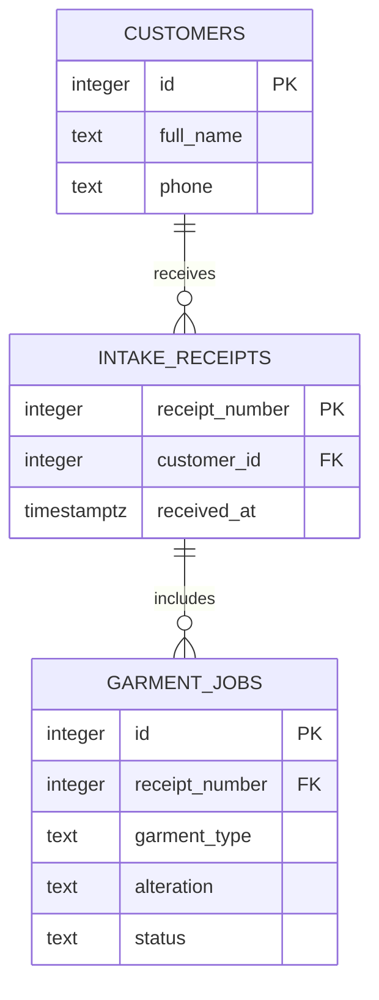

# Where Are My Clothes? | Tailor Pickup Database

A PostgreSQL project for a tailor shop. A customer can bring several garments under one receipt and pick up each garment when its alteration is ready.

## Database design

Status is stored per garment. Trousers may be ready while a jacket from the same receipt still needs a new zipper. Identity primary keys uniquely identify each record. Required foreign keys enforce both one-to-many relationships. Restricted deletion protects linked receipts and jobs. A CHECK constraint limits garment status to the four workflow states.

## Run in pgAdmin

Create a fresh empty database named `tailor_pickup_db` and open its Query Tool. If you created the schema during class, use your existing matching schema and start at step 2 if sample data has not been loaded, or use a separate empty database for a clean reproduction.

1. Run [01-schema.sql](01-schema.sql) to create the three tables.
2. Run [02-sample-data.sql](02-sample-data.sql) once. It inserts one fictional customer, one receipt, and three garment jobs.
3. Run [03-queries.sql](03-queries.sql). Highlight and run each statement in order in the same Query Tool tab to see the separate outputs.
4. Run [04-transactions.sql](04-transactions.sql) once. The final SELECT checks both outcomes.
5. Run [05-index.sql](05-index.sql) statement by statement in the same Query Tool tab. Capture both plans before running the final ROLLBACK.

## Observed verification

All five scripts executed in an isolated PGlite 0.6.0 database (PostgreSQL 19.0 engine), separate from the Windows PostgreSQL 18.7 installation.

| Operation | Observed result |
| --- | --- |
| Create and read | Coat added with the default status `received` |
| Update | Same Coat changed to `ready` |
| Delete | One Coat deleted and zero demonstration rows remained |
| JOIN | Deniz Kaya had one item ready, Trousers |
| GROUP BY | One job each in `in_progress`, `ready`, and `received` |
| Pagination | Trousers and Jacket on page 1, Shirt on page 2 |
| COMMIT | Demo customer and linked receipt both present |
| ROLLBACK | Demo customer and linked receipt both absent |

The index test uses 60,000 synthetic rows in a temporary copy. The lookup for receipt 12000 returned three rows in both runs.

| Run | Plan | Execution time |
| --- | --- | --- |
| Before indexing | Sequential scan, 59,997 rows removed by filter | 5.092 ms |
| After indexing | Index scan using the receipt number | 0.057 ms |

These are single-run timings from the isolated test. The plan shows how a selective receipt lookup can use a B-tree index. On a small table a sequential scan may still be cheaper. An index also uses space and adds maintenance work during writes. The benchmark leaves the assignment tables untouched. See [verification-output.txt](verification-output.txt) for the captured results.

## AI use

The project idea was selected by the student after discussing options with ChatGPT. ChatGPT drafted the schema, fictional sample data, demonstration queries, and documentation. The scripts were executed against an isolated PostgreSQL engine and the results recorded above. The AI assistance includes generating the benchmark data and the proposed receipt-number index.
